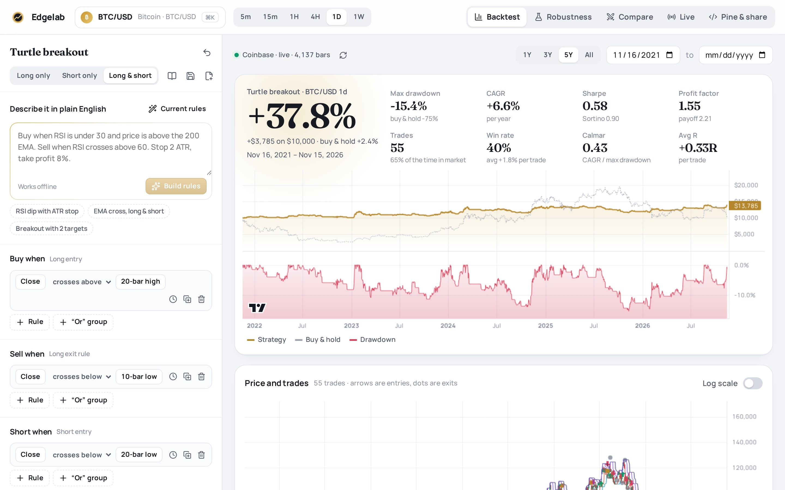
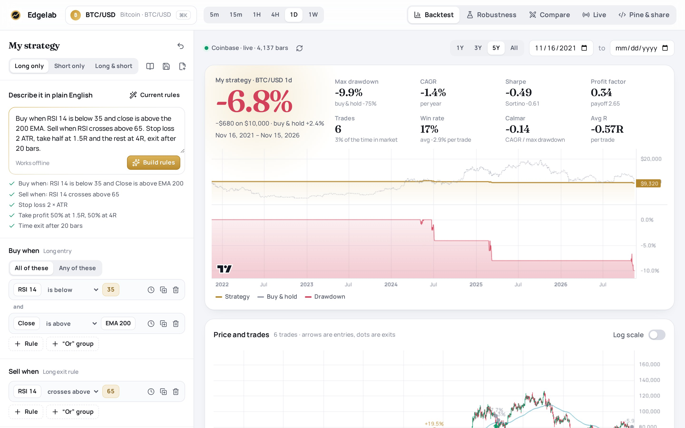
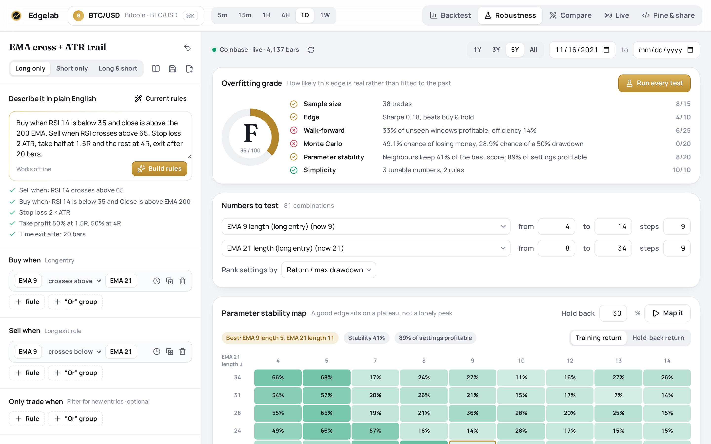
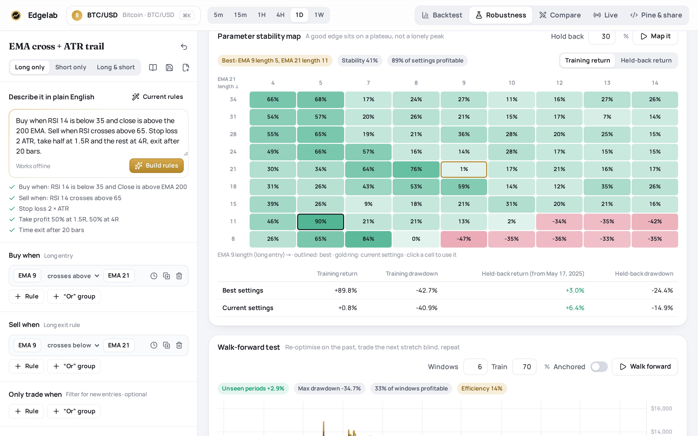
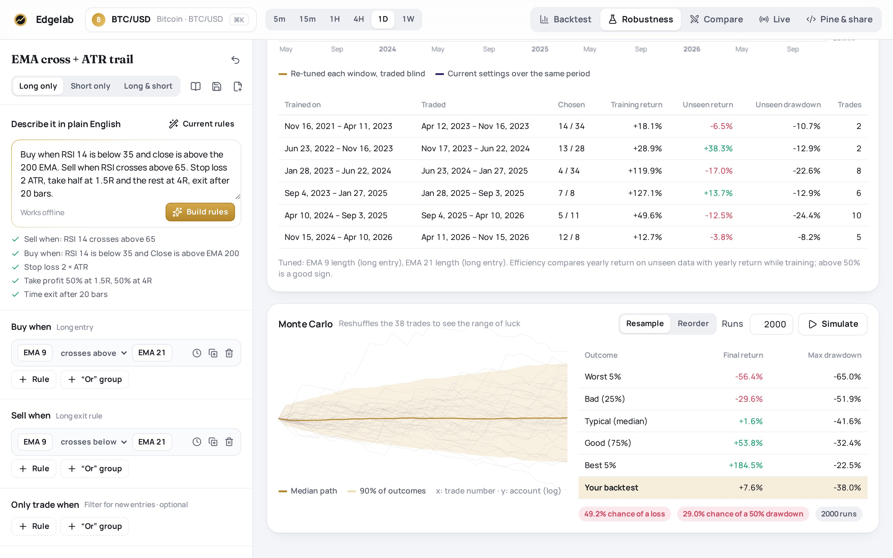
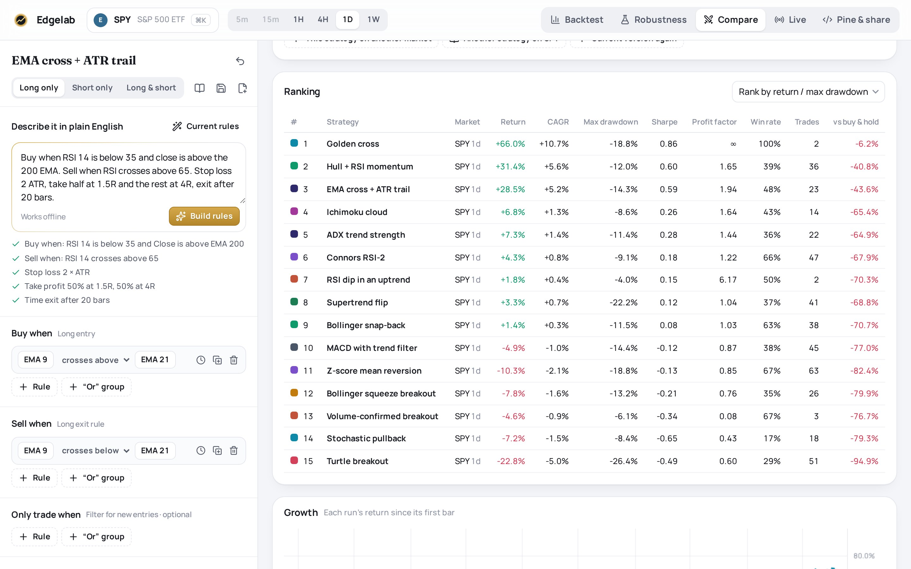
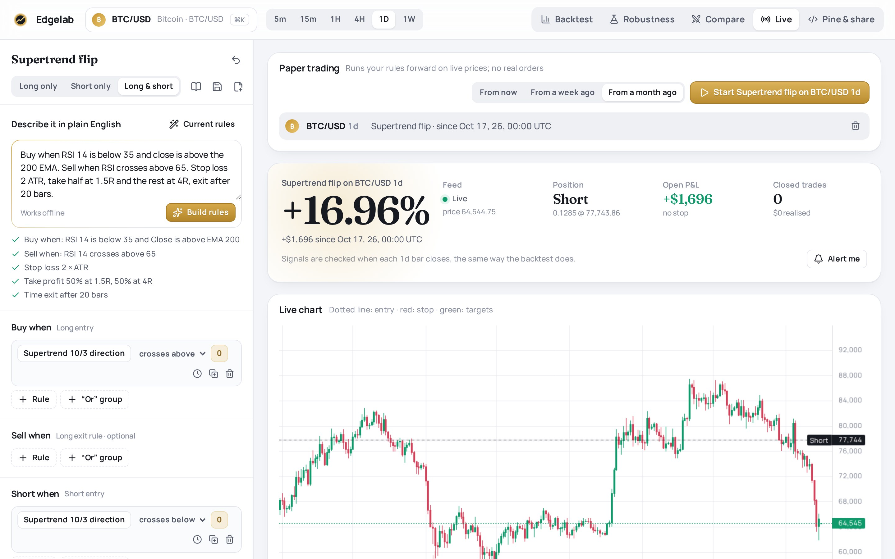
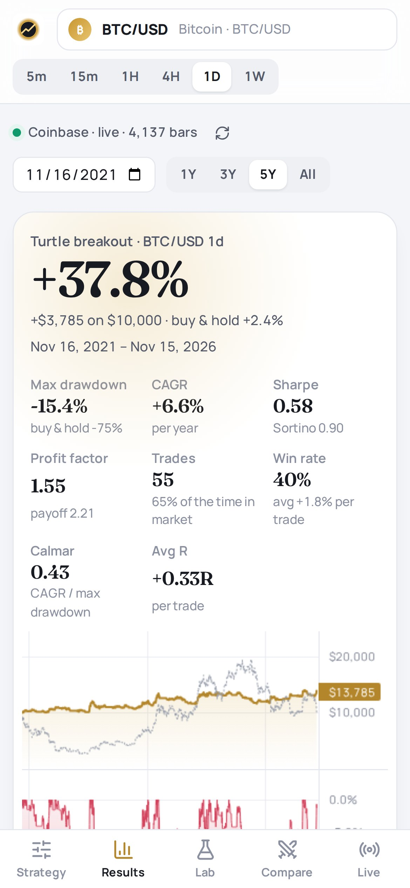
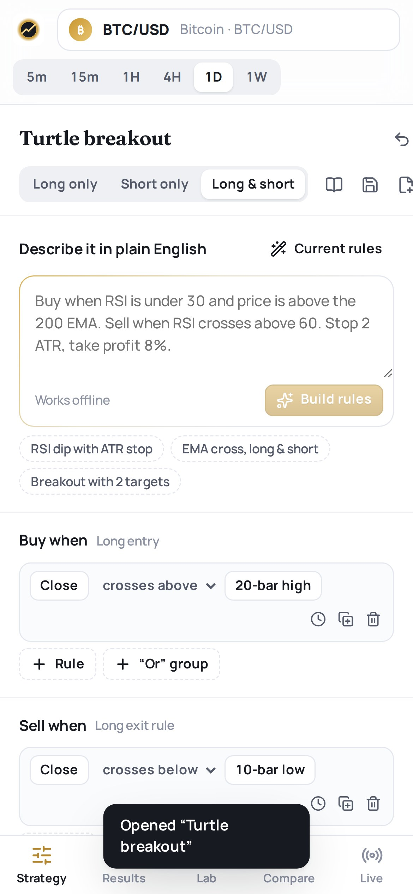
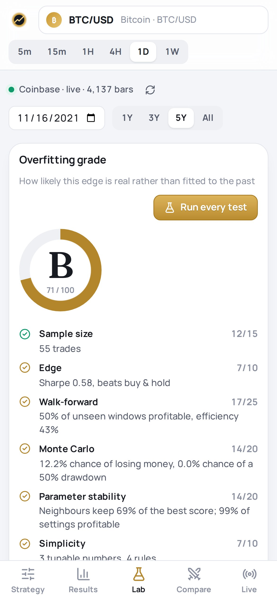

# Edgelab: trading strategy lab (React + TypeScript, web and Android)

Edgelab builds, backtests and stress-tests trading strategies on **any market**: stocks, ETFs, indexes, forex, futures and every crypto pair. You can write rules in a visual builder or describe them in **plain English**. It then tells you how likely the result is to hold up: walk-forward testing, Monte Carlo, a parameter stability map and an overfitting grade from A to F. Strategies can be **paper traded live**, raced head to head, and exported to TradingView Pine Script.

- **Live web app:** [neomaverick1.github.io/edgelab](https://neomaverick1.github.io/edgelab/)
- **Android app:** [download Edgelab.apk](https://neomaverick1.github.io/edgelab/Edgelab.apk) (also on the [Releases page](https://github.com/neomaverick1/edgelab/releases/latest)).
- **iPhone and iPad:** open the web app in Safari, tap Share, then **Add to Home Screen**. It installs as a full-screen app with its own icon and works offline. The native iOS project is in [`ios/`](ios) and CI builds it on every push.



<p>
  
  
</p>
<p>
  
  
</p>
<p>
  
  
</p>
<p>
  
  
  
</p>

## What it does

| | |
| --- | --- |
| **Any market** | The Android app loads any ticker live from Yahoo Finance (stocks, ETFs, indexes, forex, futures, crypto) on 5-minute to weekly bars. The website streams every Coinbase and Binance pair live, plus a daily snapshot of 200 popular stocks, ETFs, forex pairs and futures. Anything else can come from a CSV file (TradingView, Yahoo, MetaTrader and broker exports are recognised). |
| **Rule builder** | 40+ indicators and outputs: moving averages (SMA, EMA, WMA, Hull, DEMA, VWAP), RSI, Stochastic, Stoch RSI, MACD, ADX/DMI, Aroon, CCI, ROC, Williams %R, Z-score, regression slope, Bollinger, Keltner, Donchian, ATR, Supertrend, Parabolic SAR, Ichimoku, volume, OBV, MFI, CMF, candle patterns, and hour, weekday and month filters. Rules compare any two values (crosses above or below, above, below, rising, falling, “within the last N bars”, “N bars ago”) and combine with AND/OR groups, separately for long entries, long exits, short entries, short exits and a shared filter. |
| **Exits and sizing** | Several exits at once: fixed or ATR stop, trailing stop with an optional start, a take-profit ladder in %, ATR or R multiples, move-to-breakeven, time exit and the exit rules. Size by % of equity, % risked per trade or a fixed amount, with a leverage cap and scaling in. Fees and slippage on every fill. |
| **Plain English** | “Buy when RSI is under 30 and close is above the 200 EMA. Sell when RSI crosses above 60. Stop 2 ATR, take half at 2R and the rest at 5R, risk 1% per trade.” The parser runs on the device with no AI service. It shows what it understood and what it couldn’t read, and can write any rule set back into a sentence. |
| **Backtest** | No look-ahead: signals are read when a bar closes and filled at the next open. Stops and targets are checked inside each bar, the stop first if a bar touches both, and a gap fills at the open. Results include return, CAGR, max drawdown and its length, Sharpe, Sortino, Calmar, ulcer index, profit factor, payoff, R multiples, MAE/MFE, exposure, long/short split, how each trade ended, monthly returns, and buy and hold for comparison. |
| **Robustness lab** | A **stability map** of any two numbers (indicator lengths, levels, stop and target sizes) with a held-back test. **Walk-forward** testing re-tunes on each training window and trades the next one blind, with rolling or anchored windows. **Monte Carlo** resamples or reorders the trades thousands of times. Together they give an **overfitting grade** with the reasons behind it. Heavy work runs in a Web Worker. |
| **Head to head** | Run any mix of strategies and markets on the same dates and costs. Rank them by return over drawdown, Sharpe, Calmar, profit factor or return, and overlay their growth curves. |
| **Live paper trading** | Runs a strategy forward on live prices (WebSockets for Binance and Coinbase, polling for Yahoo in the app). It shows the open position with its stop and targets on the chart, plus paper trades and browser alerts. Sessions are saved and pick up where they left off. |
| **Library and sharing** | 15 classic systems built from ordinary rules (Turtle, Connors RSI-2, golden cross, Supertrend, Ichimoku, Bollinger squeeze, z-score reversion…). You can also save your own strategies, undo and redo changes, share a link with the whole setup, and export a TradingView Pine Script v6 strategy with the same rules, exits, sizing and costs. |

## How it is built

- **React 19 + TypeScript (strict)**, built with Vite. Charts use [lightweight-charts](https://github.com/tradingview/lightweight-charts) and the Monte Carlo chart is plain SVG.
- **Rule engine** ([`src/lib/rules.ts`](src/lib/rules.ts), [`src/lib/catalog.ts`](src/lib/catalog.ts)): a strategy is plain JSON, made of condition trees over a catalog of indicators. Each indicator knows how to compute itself, draw itself and write itself in Pine Script.
- **Backtester** ([`src/lib/engine.ts`](src/lib/engine.ts)): event-driven. It handles partial exits, scale-ins, risk-based sizing, leverage and liquidation, and can keep a position open for live trading.
- **Robustness** ([`src/lib/robustness.ts`](src/lib/robustness.ts)): grids, walk-forward, Monte Carlo with a seeded random generator, and the grade.
- **Plain English** ([`src/lib/english.ts`](src/lib/english.ts)): a pattern-based parser and writer. The tests check that every built-in system survives a round trip from rules to words and back.
- **Data** ([`src/lib/data`](src/lib/data)): Coinbase, Binance, Yahoo Finance, CSV, resampling (1h → 4h, 1d → 1w) and live feeds. In the Android app, requests go through the native HTTP stack, so Yahoo Finance works without a server.
- **Android and iOS:** [Capacitor](https://capacitorjs.com) apps ([`android/`](android), [`ios/`](ios)) that wrap the same build. The website is also an installable web app with an offline service worker.
- **CI** ([`.github/workflows/build.yml`](.github/workflows/build.yml)) runs on every push. It type-checks, lints and runs the tests, downloads the market snapshot, deploys the website, builds a signed APK and the iOS app on a Mac runner, and publishes a release. A daily scheduled run refreshes the snapshot after the US close.

## Run it

```bash
npm install
npm run dev          # http://localhost:5173 (crypto loads live; stocks need the snapshot below)
npm run data         # download the stock/forex/futures snapshot into public/data/markets
npm test             # 78 tests: engine, exits, sizing, indicators, English parser, Pine export, CSV, robustness
npm run build
npm run android      # build and copy into the Android project, then open android/ in Android Studio
npm run ios          # build and copy into the iOS project, then open ios/App/App.xcodeproj in Xcode
```

The APK in the releases is signed with a demo key that is kept in the repository, so each new build installs over the last one. Sign with your own private key before publishing to Google Play.

## Credits

Market data from Coinbase, Binance and Yahoo Finance; charts by TradingView’s lightweight-charts (Apache 2.0); icons by Lucide (ISC); fonts Manrope, Fraunces and JetBrains Mono (SIL Open Font License). This is a research tool, not financial advice: past results don’t promise future ones.

## License

MIT © 2026 Randy Kundinger
