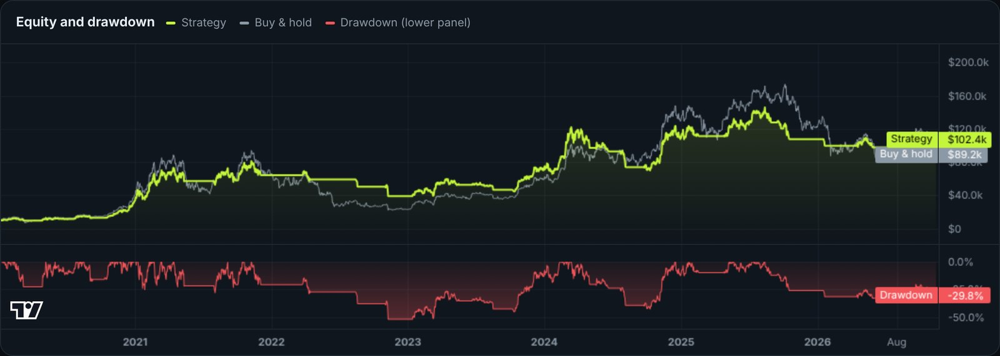
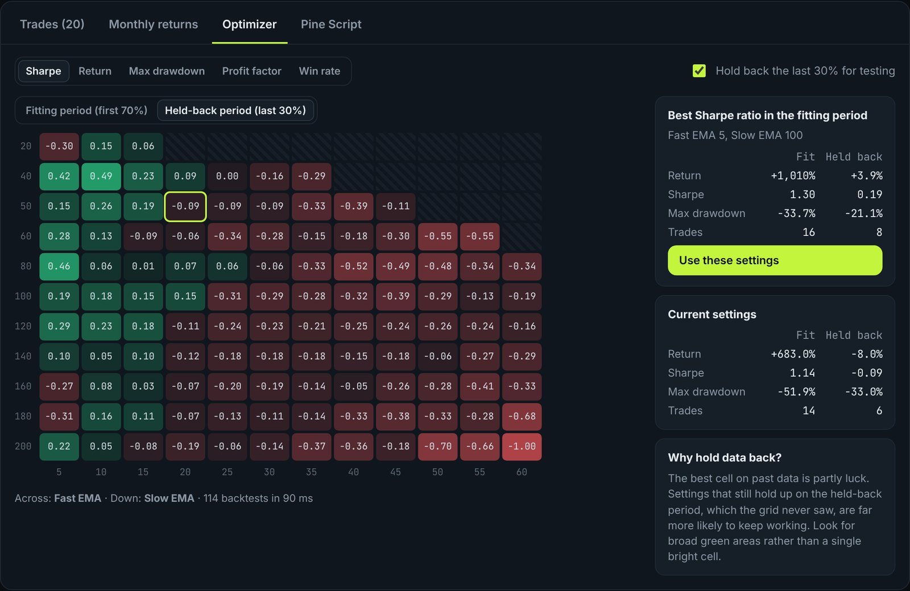
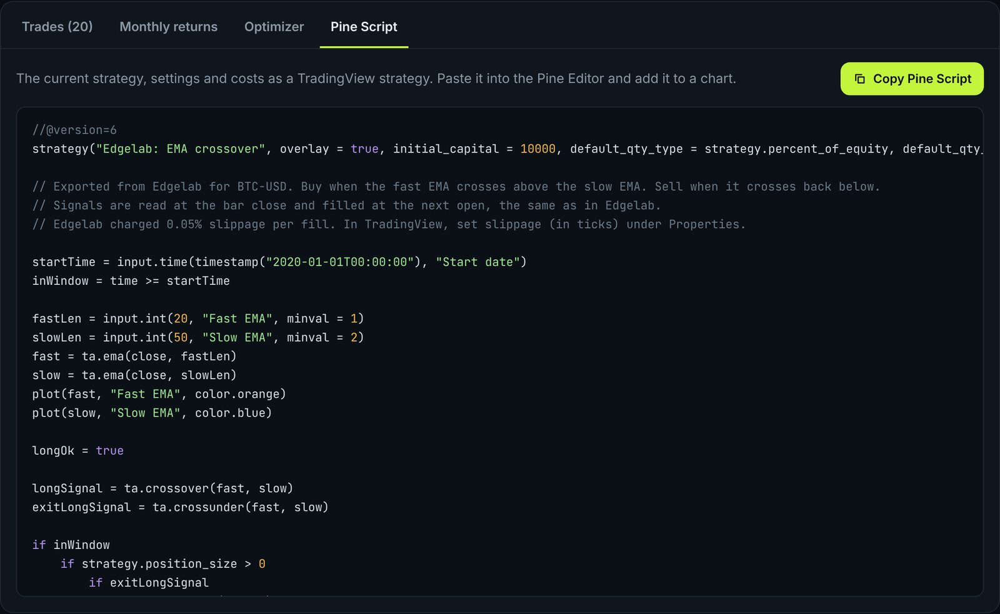
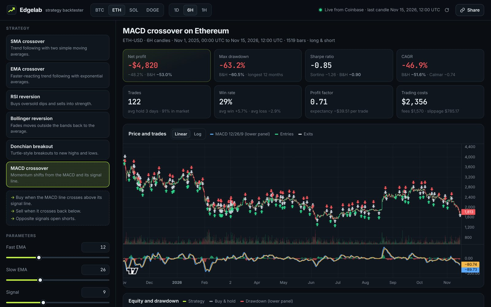
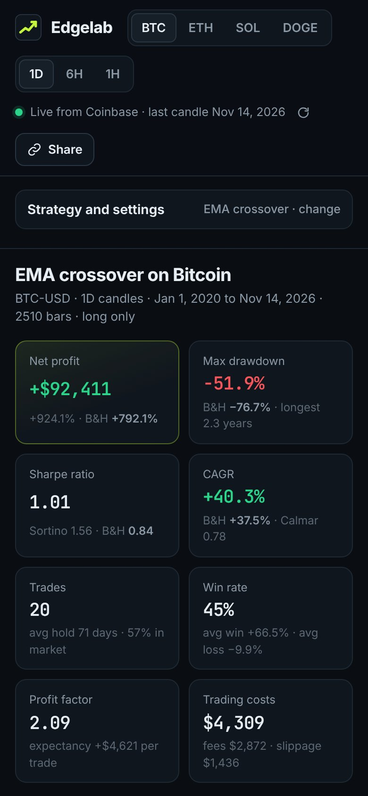

# Edgelab: trading strategy backtester (web)

A **React + TypeScript** web app for testing trading strategies on **real crypto market data**. Pick a strategy, tune it, add stops, fees and slippage, and see every trade, the equity curve against buy & hold, the drawdown and the monthly returns update instantly. An **optimizer** tests every parameter combination and checks the winners on data it held back, and any setup **exports to TradingView Pine Script**.

**Live demo:** [neomaverick1.github.io/edgelab](https://neomaverick1.github.io/edgelab/)




<p>
  
  
</p>
<p>
  
  
</p>

Every push to `main` type-checks, lints and tests the code, refreshes the market data and redeploys the site ([`.github/workflows/build.yml`](.github/workflows/build.yml)).

## Features

| Area                  | What it does                                                                                                                                                                                                                                                                                                                    |
| --------------------- | ------------------------------------------------------------------------------------------------------------------------------------------------------------------------------------------------------------------------------------------------------------------------------------------------------------------------------- |
| **Market data**       | Daily, 6-hour and 1-hour candles for Bitcoin, Ethereum, Solana and Dogecoin from Coinbase's public API. The browser tops the data up live on every visit; a bundled snapshot keeps the app working if Coinbase can't be reached.                                                                                                |
| **Strategies**        | SMA crossover, EMA crossover, RSI reversion, Bollinger reversion, Donchian breakout and MACD crossover, each with adjustable parameters, plus an optional trend filter (only buy above the 50, 100 or 200-day average).                                                                                                         |
| **Realistic fills**   | Signals are read at the close and filled at the next open, so the test never sees the future. Fees and slippage on every fill. Stop loss, take profit and trailing stop are checked inside each bar. Long only, or long & short (a short is closed before the account can go below zero, like an exchange would).               |
| **Results**           | Net profit, max drawdown and how long it lasted, Sharpe and Sortino ratios, CAGR, Calmar, win rate, profit factor, expectancy, time in market and total trading costs, each next to buy & hold.                                                                                                                                 |
| **Charts**            | Candles with the strategy's indicators and trade arrows (RSI and MACD in a panel below), equity against buy & hold with the drawdown underneath. Both charts scroll and zoom together, with a linear or log price scale.                                                                                                        |
| **Trades and months** | Every trade with entry, exit, holding time, return and why it closed. Click one to jump to it on the chart, or download them all as CSV. A calendar table shows the return of every month and year.                                                                                                                             |
| **Optimizer**         | Backtests every combination of two parameters in a background thread and colours a heatmap by Sharpe, return, drawdown, profit factor or win rate. It can hold back the last 30% of the data and show how the best settings did on data they never saw, the honest way to spot overfitting. Click any cell to use its settings. |
| **Pine Script**       | The current strategy, costs, stops, trend filter and dates as a TradingView Pine Script v6 strategy, ready to paste into the Pine Editor.                                                                                                                                                                                       |
| **Share links**       | Every setting lives in the page address, so a backtest can be sent as a link.                                                                                                                                                                                                                                                   |

## How the backtester works

- **No look-ahead.** Indicators only use bars up to the one being read ([`src/lib/indicators.ts`](src/lib/indicators.ts)). Orders placed at a bar's close fill at the next bar's open. A test changes the future candles of a price series and checks that nothing before them moves.
- **One bar at a time** ([`src/lib/engine.ts`](src/lib/engine.ts)): fill the orders from the last close, check stops and targets against the bar's high and low, mark the account to market at the close, then read the signals for the next open. If a bar touches both the stop and the target, the stop is assumed to come first, and a price that gaps through a level fills at the open.
- **Costs** are charged as a percentage fee on every fill, and slippage moves every market order's price against you. Take-profit orders are limit orders and fill at their price.
- **Metrics** ([`src/lib/metrics.ts`](src/lib/metrics.ts)): Sharpe and Sortino are annualised from bar returns with 365 days a year, since crypto trades every day. CAGR is shown once a test covers at least six months. Buy & hold pays the same fees and slippage.
- **Indicators warm up on earlier data**, so a test that starts in 2020 has a ready 200-day average on its first day.

## Run it

Requires Node 20+.

```bash
npm install
npm run dev        # open the printed address
npm run data       # optional: download fresh candles from Coinbase into public/data
```

## Checks

```bash
npm run typecheck  # TypeScript, strict mode
npm run lint       # Oxlint
npm test           # Vitest: indicators, fills, costs, stops, shorts, no look-ahead, metrics, optimizer, Pine Script export, share links, data
```

## Project structure

```
src/
  App.tsx                 Page layout, data loading and the backtest pipeline
  components/
    Controls.tsx          Strategy, parameters, test period, position, risk and costs
    PriceChart.tsx        Candles, indicators, trade arrows, lower panel (TradingView Lightweight Charts)
    EquityChart.tsx       Equity, buy & hold and drawdown
    Optimizer.tsx         Parameter heatmap with held-back testing
    TradesTable.tsx, MonthlyTable.tsx, PineExport.tsx, StatGrid.tsx
  lib/
    indicators.ts         SMA, EMA, RSI, Bollinger Bands, Donchian channels, MACD
    strategies.ts         The six strategies and their parameters
    engine.ts             The backtester
    metrics.ts            Returns, drawdowns, ratios, trade and monthly statistics
    optimizer.ts          Grid search with a held-back period
    pine.ts               Pine Script v6 export
    data.ts               Bundled snapshot plus live candles from Coinbase
    share.ts              Settings in the page address
  workers/                The optimizer's background thread
scripts/fetch-data.mjs    Downloads the candle snapshot
public/data/              The bundled candles
```

## Credits

Market data from the [Coinbase Exchange public API](https://docs.cdp.coinbase.com/exchange/reference/exchangerestapi_getproductcandles). Charts by [TradingView Lightweight Charts™](https://www.tradingview.com/lightweight-charts/) (Apache 2.0), copyright TradingView, Inc. Fonts: Inter and JetBrains Mono (SIL Open Font License) via Fontsource.

Edgelab is a demo for research and education. It is not financial advice, and past results don't promise future ones.

## License

MIT © 2026 Randy Kundinger (code). Market data and the charting library remain under their own terms.
